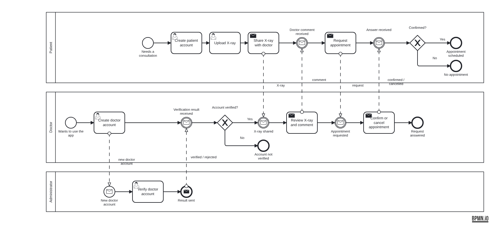

# BPMN: users and doctor-patient

Part of Problem 2, Lab 5. Component: users, roles and the doctor-patient flow.

Files:
- `user-doctor-patient.bpmn` - the model (opens in bpmn.io or Camunda Modeler)
- `user-doctor-patient.png` - exported diagram

## Participants
- **Patient**: creates an account, uploads an X-ray and shares it with a doctor,
  receives the doctor's comment, requests an appointment and gets the answer.
- **Doctor**: creates an account and waits for the verification. If verified, reviews the
  shared X-ray, comments on it, then confirms or cancels the requested appointment.
- **Administrator**: verifies new doctor accounts and sends back the result.

The three participants exchange messages (account verification, shared X-ray, comment,
appointment request and answer), which match the notifications in the
`notification` package and the appointment states in the `appointment` package.
