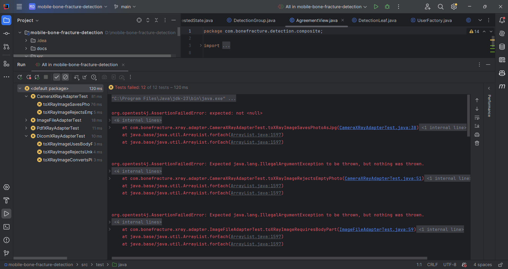
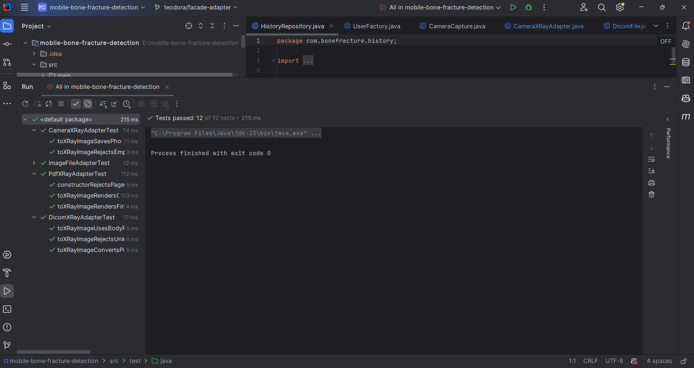
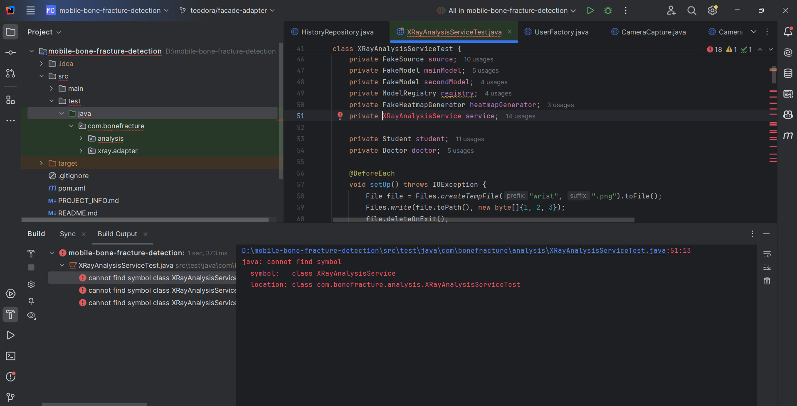
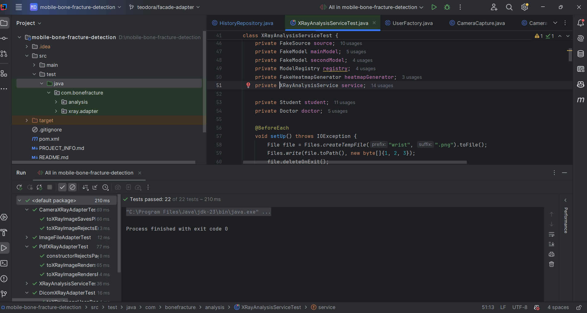

# TDD: X-ray input and analysis (Lab 5, Problem 1)

Teodora's part of Problem 1: two iterations of Test Driven Development on the Adapter + Facade code
from Lab 4, with the SOA service `XRayAnalysisService`.

Each cycle follows the TDD life cycle from the course (ASET Course 2, slide "TDD - Life cycle"):

1. Add a test
2. Run all tests and see if the new one fails
3. Write some code
4. Run the automated tests and see them succeed
5. Refactor code

Repeat.

Tests run with Maven and JUnit 5: `mvn test` (see `pom.xml` in the repository root, the same file as on
Federica's branch). Every group of steps has its own commit (`test:` = steps 1-2, `feat:` = steps 3-4,
`refactor:` = step 5), so the commit history shows that each test was written before the code.

| Iteration | Service (SOA) | Pattern | Test classes | Tests |
|---|---|---|---|---|
| 1 | - (input layer used by the service) | Adapter | `ImageFileAdapterTest`, `PdfXRayAdapterTest`, `CameraXRayAdapterTest`, `DicomXRayAdapterTest` | 4 + 3 + 2 + 3 |
| 2 | `XRayAnalysisService` | Facade | `XRayAnalysisServiceTest` | 10 |

## Iteration 1: the X-ray adapters

Goal: every way of adding an X-ray (JPG / PNG file, PDF, phone camera, DICOM) produces the same
`XRayImage`, and wrong input is rejected with `IllegalArgumentException`.
The external libraries (PDF, DICOM) are replaced in the tests by small test doubles
(`FakePdfDocument`, `FakeDicomFile`) that extend the Adaptee classes.

**Step 1 - Add a test.** 12 tests:
- `ImageFileAdapterTest` (4): keeps the path, format and body part; rejects a format that is not an image
  (PDF); rejects a missing file; requires a body part
- `PdfXRayAdapterTest` (3): renders the first page at 300 DPI and saves it as PNG next to the PDF
  (`scan-page1.png`); renders the chosen page; rejects a page outside the document
- `CameraXRayAdapterTest` (2): saves the photo as JPG in the app folder with the same bytes; rejects an empty photo
- `DicomXRayAdapterTest` (3): converts the 16-bit pixels to an 8-bit PNG (darkest pixel 0, brightest 255);
  uses the body part from the DICOM file when the user does not choose one; rejects an unknown body part

**Step 2 - Run all tests and see if the new one fails.** All 12 tests fail: the adapters were the Lab 4
skeleton (`toXRayImage()` returned `null` and nothing was checked).

**Step 3 - Write some code.**
- `ImageFileAdapter`: accepts only JPG / PNG, checks the file and the body part
- `PdfXRayAdapter`: checks the page index, renders the page and saves it as PNG
- `CameraXRayAdapter`: rejects an empty photo, saves it as `xray-<date-time>.jpg`
- `DicomXRayAdapter`: maps the DICOM body part, stretches the 16-bit pixels to 0..255 and saves a PNG;
  patient identifiers are never copied
- `PdfDocument` and `DicomFile` (Adaptees): a `getFile()` getter

**Step 4 - Run the automated tests and see them succeed.** 12 tests, 0 failures.

**Step 5 - Refactor code.** Three adapters repeated the body-part check and two repeated the PNG saving.
They were moved into a package-private helper, `AdapterSupport` (`requireBodyPart()`, `siblingFile()`,
`savePng()`). The adapters lost 32 lines and gained 7; the 12 tests still pass.

Commits: `b5058f9` (steps 1-2), `d58ca29` (steps 3-4), `ce3f950` (step 5).

## Iteration 2: the facade and XRayAnalysisService

Goal: one service is the entry point for analysing an X-ray. Students and patients get one analysis with
the main model; a doctor verified by an administrator can compare every model. The subsystems
(preprocessor, models, heatmap generator) are replaced in the tests by small test doubles.

**Step 1 - Add a test.** `XRayAnalysisServiceTest` (10 tests), written before the service existed:
- `analyzeXRay` uses the main model
- `analyzeXRay` converts the source with the chosen body part and adds the result to the X-ray
- the steps run in order: resize -> normalize -> detection
- every detection gets a heatmap
- the X-ray is saved in the user's history (another user does not see it)
- an invalid image throws `IllegalArgumentException` and never reaches the model or the history
- without a main model, `IllegalStateException`
- `compareModels` runs every model for a verified doctor, each result with heatmaps
- `compareModels` for a doctor who is not verified throws `IllegalStateException`
- the history of a user without X-rays is empty

**Step 2 - Run all tests and see if the new one fails.** The build fails: `XRayAnalysisService` cannot be found.

**Step 3 - Write some code.**
- `XRayAnalysisService`: the SOA interface (`analyzeXRay`, `compareModels`, `getHistory`)
- `FractureAnalysisFacade` implements it: adapter -> validation -> main model (or all models) ->
  preprocessing -> detection through `FractureDetector` (Strategy) -> heatmaps -> history
- `ModelRegistry.getMainModel()`, `HistoryRepository` (in memory, per user), `Detection.setHeatmap()`,
  `XRayImage.validate()` (file exists and is not empty, format and body part known)

**Step 4 - Run the automated tests and see them succeed.** 22 tests (10 new + 12 from iteration 1), 0 failures.

**Step 5 - Refactor code.** `analyzeXRay` and `compareModels` repeated the same steps. They became three
private methods: `convertAndValidate()`, `preprocess()` and `runModel()` (model + detection + heatmaps).
The two public methods now read as a list of steps; the 22 tests still pass.

Commits: `6136d74` (steps 1-2), `ee27a9b` (steps 3-4), `a72c98f` (step 5).
