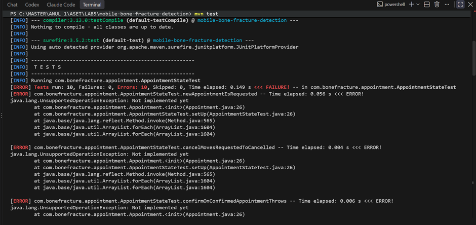
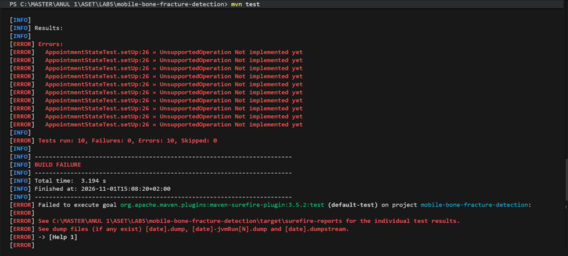
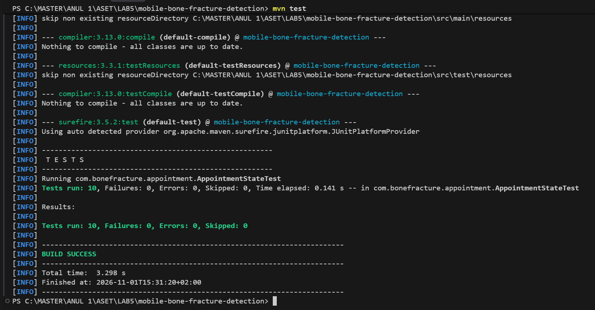
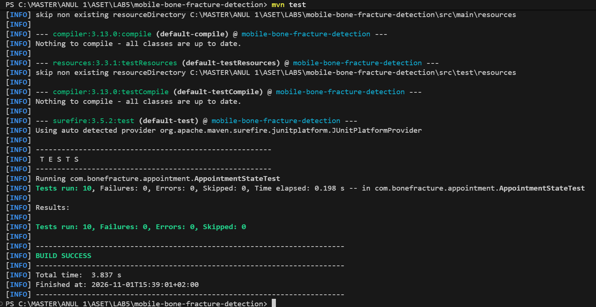
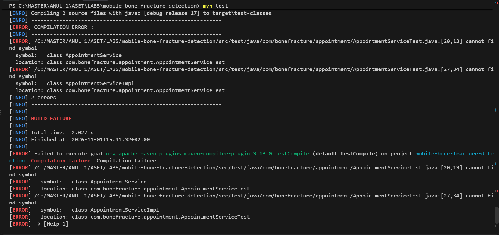
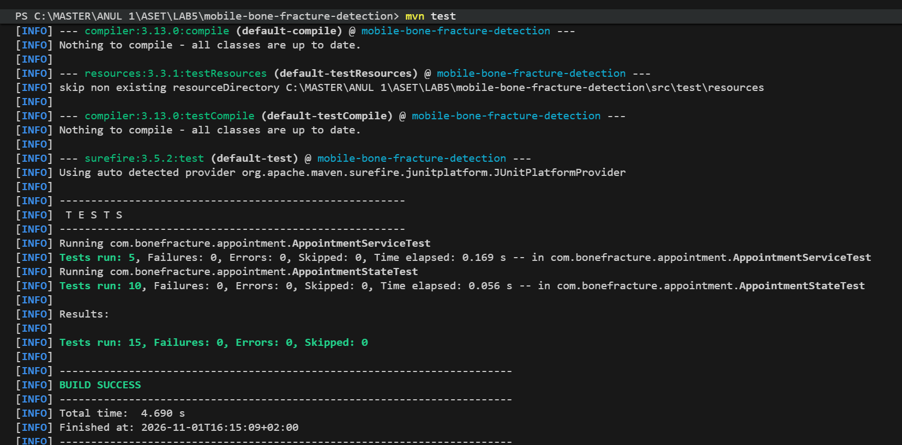
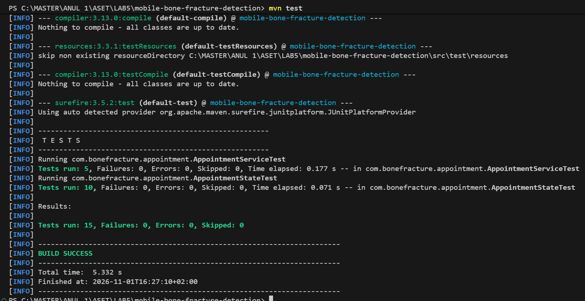
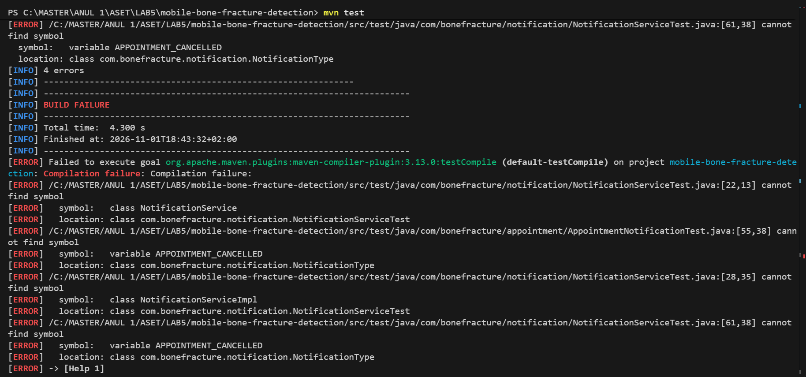
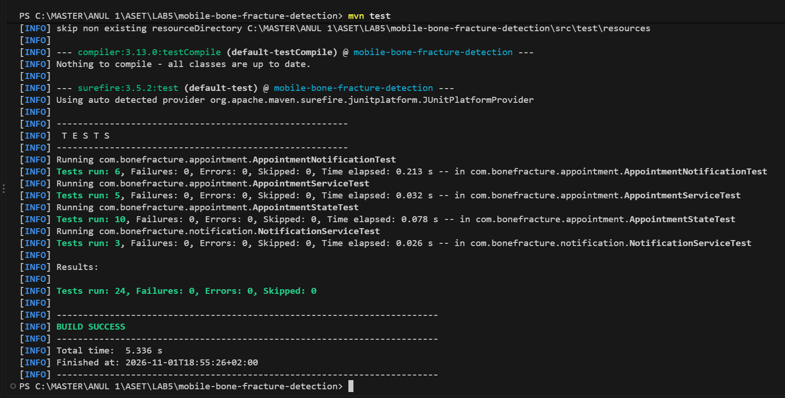
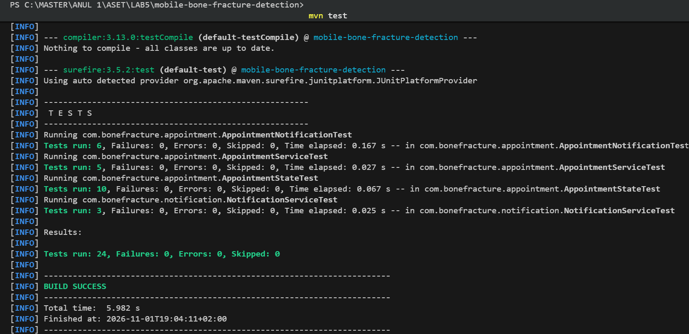

# TDD: appointments and notifications (Lab 5, Problem 1)

Federica's part of Problem 1: two iterations of Test Driven Development on the State + Observer code
from Lab 4, with the SOA services `AppointmentService` and `NotificationService`.

Each cycle follows the TDD life cycle from the course (ASET Course 2, slide "TDD - Life cycle"):

1. Add a test
2. Run all tests and see if the new one fails
3. Write some code
4. Run the automated tests and see them succeed
5. Refactor code

Repeat.

Tests run with Maven and JUnit 5: `mvn test` (see `pom.xml` in the repository root).
Every group of steps has its own commit (`test:` = steps 1-2, `feat:` = steps 3-4, `refactor:` = step 5),
so the commit history shows that each test was written before the code.

| Iteration | Service (SOA) | Pattern | Test classes | Tests |
|---|---|---|---|---|
| 1 | `AppointmentService` | State | `AppointmentStateTest`, `AppointmentServiceTest` | 10 + 5 |
| 2 | `NotificationService` | Observer | `AppointmentNotificationTest`, `NotificationServiceTest` | 6 + 3 |

## Iteration 1: appointment states and AppointmentService

Goal: the state transitions Requested -> Confirmed -> Cancelled; an action that is not allowed
in the current state throws `IllegalStateException`. The iteration has two TDD cycles.

### Cycle 1: appointment states

**Step 1 - Add a test.** `AppointmentStateTest` (10 tests):
- a new appointment is REQUESTED
- confirm: Requested -> Confirmed; cancel: Requested -> Cancelled and Confirmed -> Cancelled
- sendReminder keeps a confirmed appointment Confirmed
- not allowed, throws `IllegalStateException`: confirm when Confirmed, sendReminder when Requested,
  confirm / cancel / sendReminder when Cancelled

**Step 2 - Run all tests and see if the new one fails.** All 10 tests fail: `Appointment` and the
states only threw `UnsupportedOperationException` (Lab 4 skeleton).

**Step 3 - Write some code.** `Appointment` starts in `RequestedState` and delegates `confirm()`,
`cancel()` and `sendReminder()` to its current state. `RequestedState`, `ConfirmedState` and
`CancelledState` change the state or throw `IllegalStateException`.

**Step 4 - Run the automated tests and see them succeed.** 10 tests, 0 failures.

**Step 5 - Refactor code.** The states have no fields, so each state now has one shared `INSTANCE`
instead of creating a new object on every transition. During this step a mistake in
`ConfirmedState.INSTANCE` made 4 tests fail; it was fixed and all tests passed again.

Commits: `b75fb10` (steps 1-2), `5ed366e` (steps 3-4), `f5a0d13` (step 5).

### Cycle 2: AppointmentService

**Step 1 - Add a test.** `AppointmentServiceTest` (5 tests), written before the service existed:
- `requestAppointment` creates a REQUESTED appointment with the given doctor, patient and date
- `confirm` and `cancel` through the service change the state
- `sendReminder` keeps a confirmed appointment Confirmed
- an action that is not allowed throws `IllegalStateException` through the service

**Step 2 - Run all tests and see if the new one fails.** The build fails: `AppointmentService`
and `AppointmentServiceImpl` cannot be found.

**Step 3 - Write some code.** The `AppointmentService` interface and `AppointmentServiceImpl`,
which creates the appointment and passes every action to it (the rules stay in the state classes).
The `Appointment` getters needed by the tests.

**Step 4 - Run the automated tests and see them succeed.** 15 tests, 0 failures.

**Step 5 - Refactor code.** Every test created the same appointment; it is now created once in `setUp()`.

Commits: `8c2a4fc` (steps 1-2), `a309203` (steps 3-4), `950d689` (step 5).

## Iteration 2: notifications and NotificationService

Goal: the observers receive a notification with the correct type on every change; `attach()` and `detach()`.

**Step 1 - Add a test.**
`AppointmentNotificationTest` (6 tests):
- confirm sends `APPOINTMENT_CONFIRMED` to the patient
- cancel sends `APPOINTMENT_CANCELLED`
- sendReminder sends `APPOINTMENT_REMINDER`
- all attached observers are notified; a detached observer is not notified
- an action that is not allowed sends no notification

`NotificationServiceTest` (3 tests):
- the notifications of a tracked appointment are saved for the user
- `getNotificationsFor(user)` returns only that user's notifications
- a user without notifications gets an empty list

**Step 2 - Run all tests and see if the new one fails.** The build fails: `NotificationService`,
`NotificationServiceImpl` and `NotificationType.APPOINTMENT_CANCELLED` do not exist.

**Step 3 - Write some code.**
- `APPOINTMENT_CANCELLED` added to `NotificationType` (a cancellation is a change too)
- `AbstractNotificationSubject`: `attach()`, `detach()`, `notifyObservers()`
- `Notification`: constructor, `getType()`, `getRecipient()`
- `NotificationHistoryObserver`: keeps every notification and filters them by user
- `NotificationService` + `NotificationServiceImpl`: `track(subject)` attaches the history observer,
  `getNotificationsFor(user)` returns the user's notifications
- the states notify the patient after confirm, cancel and sendReminder

**Step 4 - Run the automated tests and see them succeed.** 24 tests, 0 failures.

**Step 5 - Refactor code.** The states repeated
`notifyObservers(new Notification(type, appointment.getPatient(), message))` four times;
it is now one method, `Appointment.notifyPatient(type, message)`.

Commits: `9be7f43` (steps 1-2), `64ca44d` (steps 3-4), `8756be5` (step 5).
